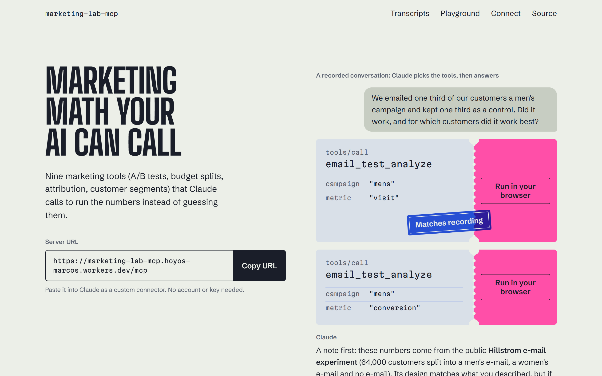
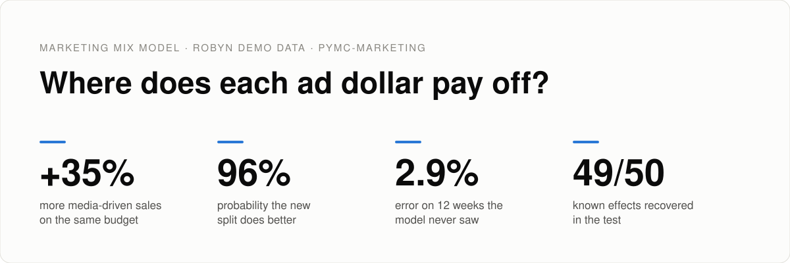
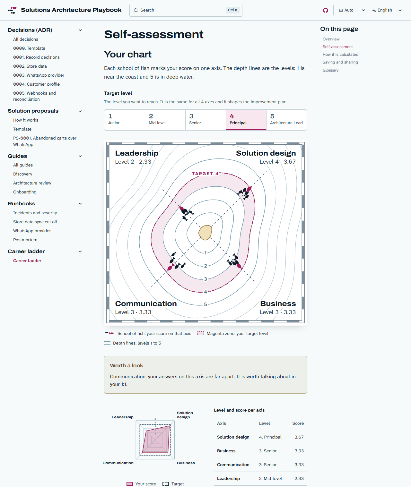

<picture>
  <source media="(prefers-color-scheme: dark)" srcset="assets/header-dark.svg">
  
</picture>

I design solutions that connect systems, data and processes. I start from the business problem, choose the architecture and build it with APIs, events and automations that another team can run.

<table>
  <tr>
    <td width="33%" valign="top"><b>Architecture</b> I turn a business need into a concrete design: platforms, flows and rules.</td>
    <td width="33%" valign="top"><b>Integration</b> I connect platforms through APIs and events, so each piece of data is entered once.</td>
    <td width="33%" valign="top"><b>Automation</b> I replace manual tasks with flows that run on their own.</td>
  </tr>
</table>

## Featured projects

<table>
  <tr>
    <td width="33%" valign="top"> <b><a href="https://github.com/hysmarcos/marketing-lab-mcp">marketing-lab-mcp</a></b> MCP server with 9 marketing tools. Claude calls them to run the numbers instead of guessing.</td>
    <td width="33%" valign="top"><a href="https://hysmarcos.github.io/marketing-mix-model/"><picture><source media="(prefers-color-scheme: dark)" srcset="assets/mmm-dark.svg"></picture></a> <b><a href="https://github.com/hysmarcos/marketing-mix-model">marketing-mix-model</a></b> Bayesian model that splits ad budget across channels: +35% media sales at the same spend.</td>
    <td width="33%" valign="top"><a href="https://hysmarcos.github.io/solutions-architecture-playbook/"><picture><source media="(prefers-color-scheme: dark)" srcset="assets/playbook-dark.png"></picture></a> <b><a href="https://github.com/hysmarcos/solutions-architecture-playbook">solutions-architecture-playbook</a></b> How a small solutions architecture team works, in Spanish and English: decisions, solution proposals, integration runbooks and a career ladder.</td>
  </tr>
</table>

Also: [superprecios-claros](https://github.com/hysmarcos/superprecios-claros) · [cuerpo-ar-modelos](https://github.com/hysmarcos/cuerpo-ar-modelos).

## Contact

Reach me on [LinkedIn](https://www.linkedin.com/in/hoyosmarcos/).
